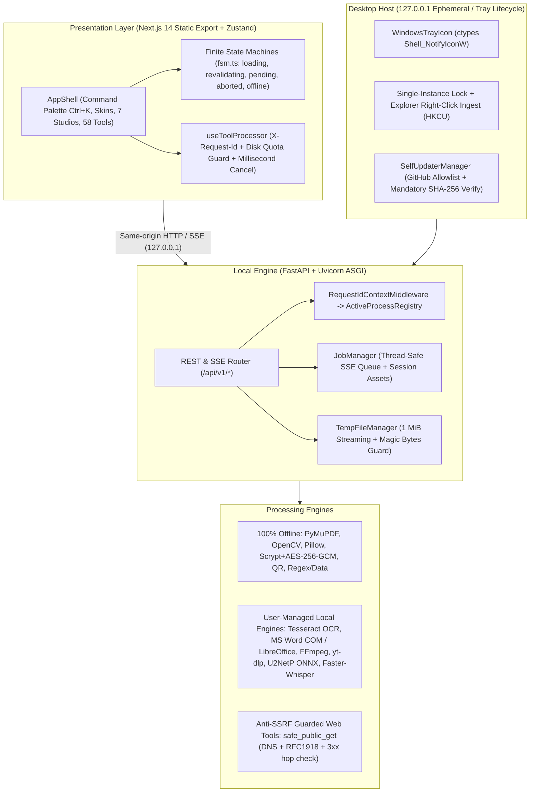

# Architecture Overview — Tornio v3.0.0

Tornio (formerly OpenPDF) is a `[LOCAL-FIRST]` desktop workbench built around strict data isolation, single-binary distribution, and composable studio pipelines. Every document transformation, video/audio render, local AI job, and cryptographic check executes on `127.0.0.1` without transmitting user payloads to external servers.

---

## System Topology

---

## Core Engineering Decisions

### 1. Local-First Isolation & Anti-SSRF Guard
- **Loopback Binding**: Uvicorn binds strictly to `127.0.0.1` on an available port in `8000–8010` with CORS restricted to loopback origins.
- **Offline Static Bundle**: The Next.js 14 UI compiles with `output: 'export'` into `frontend/out` (76 pre-rendered static routes) with embedded local fonts and vector icons (`lucide-react`), eliminating CDN dependencies at runtime.
- **Hop-by-Hop SSRF Protection** ([network.py](backend/app/utils/network.py)): Online utilities (`url-to-pdf`, `translate-pdf`, `qr-pdf/inspect`, `web-markdown-clip`, `web-headers-ssl`) resolve hostnames via DNS, block private/loopback/link-local/cloud-metadata IP ranges, and manually follow redirects via `safe_public_get` so `3xx` hops cannot pivot to internal networks.

### 2. Constant-Memory Streaming, Quota Guard & Real Subprocess Cancellation
- **Streaming Upload Validation** ([dependencies.py](backend/app/core/dependencies.py)): Uploads read in `1 MiB` chunks, validate file signatures (*magic bytes*) on the first chunk, enforce `500 MB` per-file bounds (`2 GB` for multi-file merge), and clean partial/temp files automatically.
- **Disk Space Quota Guard** ([desktop_service.py](backend/app/services/desktop_service.py)): `POST /api/v1/system/storage/check-quota` checks `shutil.disk_usage()` prior to execution, warning users below `max(300 MB, 3x input_bytes)` and halting below `50 MB`.
- **Millisecond Cancellation**: Every frontend operation attaches a unique `X-Request-Id` header captured by `RequestIdContextMiddleware` into a `contextvars.ContextVar`. Pressing Cancel aborts the client fetch AND invokes `POST /api/v1/system/cancel-request/{request_id}`, terminating active child process trees (`FFmpeg`, `yt-dlp`, etc.) immediately.

### 3. Finite State Machines in Frontend (`fsm.ts`)
- Asynchronous data flows model explicit discriminated union states (`idle`, `loading`, `revalidating`, `fetchingNextPage`, `optimistic`, `empty`, `ready`, `paused`, `offline`, `aborted`, `error`) rather than loose boolean flags, paired with dedicated visual primitives in `Loaders.tsx` and `TopProgressBar.tsx`.

### 4. Local Encrypted Vault & Cryptographic Auto-Updater
- **File Vault** ([studio_tools_service.py](backend/app/services/studio_tools_service.py)): Derives keys locally from user passphrases via `Scrypt` and encrypts payloads authenticated with `AES-256-GCM`.
- **Self-Updater Integrity** ([desktop_service.py](backend/app/services/desktop_service.py)):
  1. Network checks use a `<= 3s` timeout with cached `6h` TTL and silent offline fallback (`200 OK`, `online: false`), or zero network traffic in `manual` mode.
  2. Downloads strictly enforce HTTPS and redirect validation against `ALLOWED_UPDATE_HOSTS` (`github.com`, `api.github.com`, `objects.githubusercontent.com`, `release-assets.githubusercontent.com`).
  3. Before executing any downloaded installer or portable swap script, `SelfUpdaterManager` verifies a constant-time `SHA-256` digest against `SHA256SUMS.txt` and deletes mismatched files on failure.

### 5. Desktop Lifecycle & Single-Instance Wake
- Preferences in `%LOCALAPPDATA%\Tornio\config.json` (`desktop` block) are written at install time by Inno Setup ([Tornio_Installer.iss](installer/Tornio_Installer.iss)) and synchronized live from Settings -> System & Desktop (`HKCU` Windows autostart and `"Abrir con Tornio"` Explorer context menu, zero UAC required).
- Launching `Tornio.exe` while running checks `%LOCALAPPDATA%\Tornio\instance.json` and `/health`; if active, it forwards optional file paths to `/api/v1/system/open-window` for instant Session Files ingestion instead of spawning duplicate processes.
