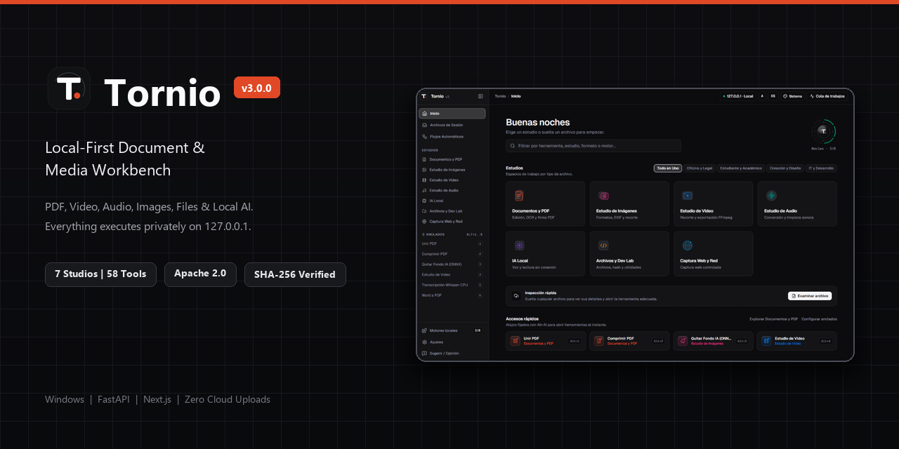
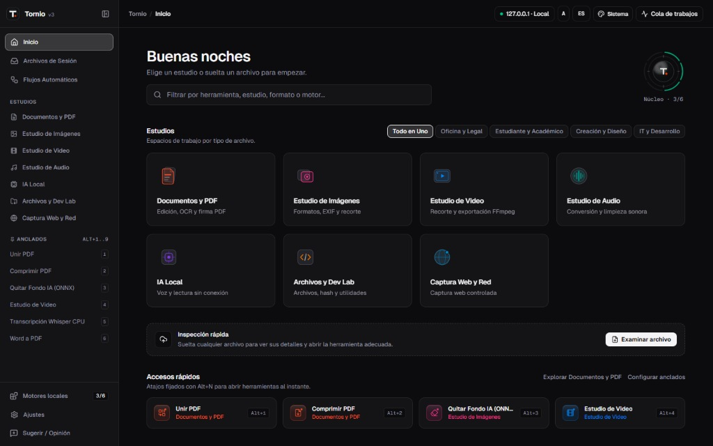
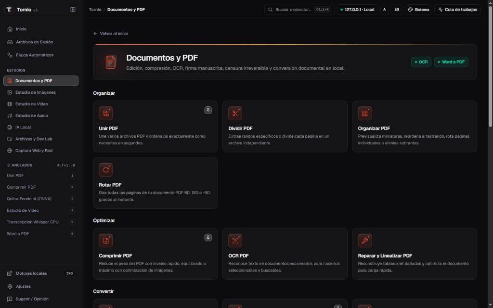
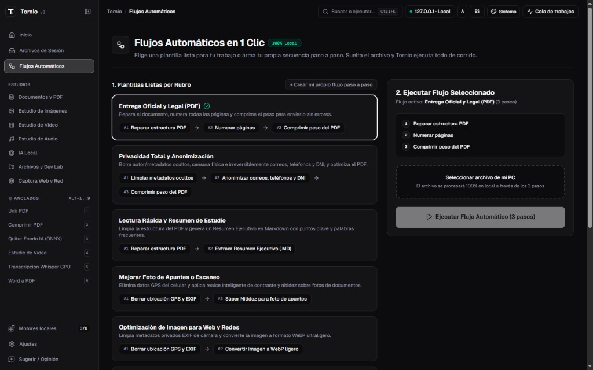

<div align="center">
  
  <br><br>

  <h1>Tornio <small>(antes OpenPDF)</small></h1>

  <p>
    <a href="README.md">Read in English</a>
    &nbsp;|&nbsp;
    <a href="https://albert-dilas.github.io/OpenPDF/">Sitio Web Oficial</a>
    &nbsp;|&nbsp;
    <a href="https://github.com/albert-dilas/OpenPDF/releases/tag/v3.0.0">Descargas y Releases (v3.0.0)</a>
  </p>

  <p>
    <a href="https://github.com/albert-dilas/OpenPDF/releases/tag/v3.0.0"></a>
    <a href="LICENSE"></a>
    <a href="https://github.com/albert-dilas/OpenPDF/actions/workflows/ci.yml"></a>
    
    
    
  </p>

  <p>
    <strong>Suite de escritorio gratuita y de codigo abierto bajo arquitectura <code>[LOCAL-FIRST]</code> para documentos, video, audio, imagenes, utilidades de seguridad e IA local por CPU.</strong><br>
    Todo el procesamiento se ejecuta en privado sobre <code>127.0.0.1</code> sin subir archivos ni metadatos a servidores externos.
  </p>
</div>

---

## Descarga y Verificacion Criptografica (`v3.0.0`)

Los binarios oficiales para Windows x64 empaquetan el motor FastAPI en Python, librerias de procesamiento, soporte de bandeja del sistema y la interfaz estatica offline Next.js de 76 rutas sin necesidad de instalar Python ni Node.js.

| Archivo | Formato | Tamano | Digest SHA-256 | Descarga |
| :--- | :--- | :---: | :--- | :---: |
| **`Tornio_Setup_v3.0.0.exe`** | Instalador Windows por usuario (asistente de 3 pasos, sin UAC) | `158.0 MB` | `0c848775e54b30a7028b3aa8896388016b8c6e3fba96f0230f6640a8b6509cc7` | [Descargar Instalador](https://github.com/albert-dilas/OpenPDF/releases/download/v3.0.0/Tornio_Setup_v3.0.0.exe) |
| **`Tornio.exe`** | Ejecutable Portatil Independiente | `161.1 MB` | `026f22a99469b4cb5e2e7514819382648469647e8afefa5454804ac1c12bbbf1` | [Descargar Portatil](https://github.com/albert-dilas/OpenPDF/releases/download/v3.0.0/Tornio.exe) |
| **`SHA256SUMS.txt`** | Manifiesto de Integridad (verificado por el auto-actualizador) | — | — | [Ver Manifiesto](https://github.com/albert-dilas/OpenPDF/releases/download/v3.0.0/SHA256SUMS.txt) |

Verifica la integridad en PowerShell antes de ejecutar:

```powershell
Get-FileHash .\Tornio_Setup_v3.0.0.exe -Algorithm SHA256
```

> **Usuarios previos de OpenPDF v2.x**: Tornio migra automaticamente `%LOCALAPPDATA%\OpenPDF\config.json` y `tessdata\*.traineddata` hacia `%LOCALAPPDATA%\Tornio` en el primer arranque sin sobrescribir configuraciones ya existentes.

---

## Vista Previa de la Interfaz

<div align="center">
  
  <br>
  <em>Figura 1: Panel principal de Tornio con Nucleo de Precision calibrado (telemetria de 6 motores y zona drop), 7 Studios, perfiles por rubro y atajos Alt+1..9.</em>
</div>

<br>

<div align="center">
  
  <br>
  <em>Figura 2: Estudio de Documentos y PDF con estado vivo de motores locales (OCR / Word a PDF) y tarjetas Dual-Tone.</em>
</div>

<br>

<div align="center">
  
  <br>
  <em>Figura 3: Constructor de flujos multipaso que encadena transformaciones locales en 1 clic sin subir archivos.</em>
</div>

---

## 7 Studios y 58 Herramientas Locales

Tornio agrupa 58 herramientas activas (`TOOL_COUNT = 58`) en 7 Studios especializados dentro de un mismo entorno:

| Studio | Herramientas | Capacidades y Motores Locales | Ejecucion |
| :--- | :---: | :--- | :--- |
| **Documentos y PDF** | `24` | Unir, Dividir, Organizar, Rotar, Comprimir, OCR (Tesseract), Reparar/Linealizar, PDF a Word/JPG/Markdown/Tablas CSV, Word a PDF (MS Word COM / LibreOffice), Marca de Agua, Numeracion, Metadatos, Comparador visual/texto (`pdf-diff`), Firma/Sello, Censura fisica irreversible, Cifrado/Desbloqueo AES, Web a PDF, Traducir PDF, QR en PDF | 21 100% Offline, 3 Web Anti-SSRF |
| **Estudio de Video** | `8` | Mesa interactiva `ffprobe` + recorte IN/OUT con cola SSE en vivo, Video a GIF, Extraer Audio, Comprimir/Transcodificar, Mosaico de Miniaturas, Quemar Subtitulos, Unir Clips, Multiplicador de Velocidad (`FFmpeg`) | 100% Offline (Motor Local) |
| **Estudio de Audio** | `6` | Conversion de formatos (`MP3`/`WAV`/`FLAC`/`OGG`/`M4A`), Recorte de precision/Fade, Normalizacion EBU R128, Filtro anti-ruido, Unir Pistas, Editor ID3 (`FFmpeg`) | 100% Offline (Motor Local) |
| **Estudio de Imagenes** | `7` | Conversor WebP/AVIF y realce de nitidez para escaneos, Optimizador, Redimensionar/Recortar, Limpiador EXIF/GPS, Quitar Fondo local (`U2NetP` ONNX / OpenCV), Constructor ICO/Favicon, Inspector de Paleta | 100% Offline |
| **Archivos y Dev Lab** | `6` | Inspector/Empaquetador ZIP/TAR/GZ, Verificador SHA-256, Boveda Cifrada local (`Scrypt + AES-256-GCM`), Transformador JSON/YAML/CSV/XML, Laboratorio Regex y Diff de texto, Generador QR por lotes SVG/PNG | 100% Offline |
| **IA Local** | `4` | Transcripcion de voz en CPU (`faster-whisper` -> `SRT`/`TXT`), Narracion TTS local con Windows `SAPI5`, Resumen extractivo de documentos, Fragmentador RAG | 100% Offline |
| **Captura Web y Red** | `3` | Archivador multimedia (`yt-dlp`), Extractor Web a Markdown limpio, Inspector HTTP/Redirecciones y TLS (`safe_public_get` Anti-SSRF) | Web Intencional + Anti-SSRF |

---

## Capacidades Clave de Ingenieria y Escritorio

- **Nucleo de Precision Calibrado (`EngineOrb3D`)**: Anillo de 6 segmentos reales para motores locales, progreso dinamico de ejecucion, panel emergente de telemetria (CPU, RAM, disco libre, purga rapida de temporales) e inspeccion instantanea al soltar archivos.
- **Archivos de Sesion y Flujos Multipaso**: Inspeccion universal en `/workspace`, encadenamiento entre herramientas con 1 clic y 5 plantillas listas por rubro en `/pipelines`.
- **Ciclo de Vida Configurable en Windows**:
  - **Cierre Total por Defecto (`keep_in_background: false`)**: Al cerrar la ventana se detiene el servidor local sin consumo en segundo plano; opcion configurable de Bandeja del Sistema nativa via `ctypes`.
  - **Inicio con Windows y Menu Contextual**: Activacion opcional por usuario en HKCU (autoarranque y `"Abrir con Tornio"` en el Explorador de Windows, sin permisos UAC).
  - **Instancia Unica**: Relanzar `Tornio.exe` o abrir archivos desde el Explorador enfoca la ventana activa y carga los archivos via `/api/v1/system/open-window`.
- **Auto-Actualizador Criptografico (`SelfUpdaterManager`)**: Modos `notify`, `auto` y `manual` offline (`timeout <= 3s`, cache de 6 horas). Restringe descargas a hosts oficiales de GitHub por HTTPS y exige coincidencia exacta `SHA-256` contra `SHA256SUMS.txt` antes de ejecutar.
- **Protecciones Operativas**: Carga en streaming de `1 MiB` con validacion por *magic bytes*, **Guardia de Cuota de Disco** previa al proceso, guardado secuencial sin colisiones, cancelacion real de subprocesos en milisegundos (`X-Request-Id`) y maquinas de estados finitos (`fsm.ts`).

---

## Tornio `[LOCAL-FIRST]` frente a Servicios SaaS en la Nube

| Capacidad | Tornio (`v3.0.0`) | Suites SaaS Tradicionales |
| :--- | :--- | :--- |
| **Residencia de Datos** | `100%` en `127.0.0.1` (archivos nunca salen del PC) | Subidos a servidores externos de terceros |
| **Cuotas y Limites** | `500 MB` por archivo / `2 GB` en union, uso ilimitado | Limites diarios, topes de peso y marcas de agua |
| **Dependencia de Red** | Los estudios principales operan sin conexion | Requiere conexion permanente a Internet |
| **Cobertura Funcional** | `7` Studios integrados (`58` herramientas) y flujos | Suscripciones separadas para PDF, video, audio e IA |
| **Auditabilidad** | Codigo abierto (`Apache 2.0`) + manifiesto `SHA256SUMS.txt` | Procesamiento opaco en servidor remoto |

---

## Arranque Rapido desde el Codigo Fuente

Requisitos: **Python 3.12+**, **Node.js 20 LTS** y (solo para compilar el instalador) **Inno Setup 6**.

```powershell
git clone https://github.com/albert-dilas/OpenPDF.git
cd OpenPDF

# 1. Instalar dependencias de frontend y generar bundle estatico
npm --prefix frontend ci
npm --prefix frontend run build

# 2. Preparar entorno virtual de backend
cd backend
python -m venv .venv
.\.venv\Scripts\python -m pip install --upgrade pip
.\.venv\Scripts\python -m pip install -r requirements-dev.txt
cd ..

# 3. Iniciar servidor local en http://127.0.0.1:8000
.\backend\.venv\Scripts\python -m uvicorn app.main:app --app-dir backend --host 127.0.0.1 --port 8000
```

Para ejecutar pruebas y compilar binarios Windows, consulta [BUILD_GUIDE.md](BUILD_GUIDE.md).

---

## Indice de Documentacion

- [ARCHITECTURE.md](ARCHITECTURE.md) — Topologia del sistema, aislamiento en `127.0.0.1`, proteccion Anti-SSRF `safe_public_get` y FSM
- [BUILD_GUIDE.md](BUILD_GUIDE.md) — Configuracion local, pruebas y pipeline completo PyInstaller + Inno Setup
- [CHANGELOG.md](CHANGELOG.md) — Registro historico de cambios de `v2.2.0` y `v3.0.0`
- [CONTRIBUTING.md](CONTRIBUTING.md) — Reglas de ingenieria, politica cero emojis y checklist de PR
- [SECURITY.md](SECURITY.md) — Politica de seguridad y reporte responsable de vulnerabilidades
- [CODE_OF_CONDUCT.md](CODE_OF_CONDUCT.md) — Codigo de conducta

---

## Licencia y Gobernanza Legal

El codigo original de Tornio se distribuye bajo la licencia **Apache License, Version 2.0** ([LICENSE](LICENSE) y [NOTICE](NOTICE)).

**Aviso de Distribucion Binaria Combinada**: Los ejecutables compilados para Windows (`Tornio.exe` y `Tornio_Setup_v3.0.0.exe`) incluyen las librerias `PyMuPDF` (`fitz`) y `pymupdf4llm`, licenciadas bajo **GNU AGPL v3.0**. En estricto cumplimiento de dicha licencia, el codigo fuente correspondiente completo y el inventario detallado de dependencias de terceros se encuentran publicados de forma abierta en este repositorio y en [THIRD_PARTY_NOTICES.md](THIRD_PARTY_NOTICES.md). Los motores opcionales (`Tesseract OCR`, `FFmpeg`, `LibreOffice`, `yt-dlp`) se mantienen externos y gestionados por el usuario.

---

## Apoyo al Proyecto

Tornio es software libre y gratuito sin publicidad, muros de pago ni telemetria. Si resulta util para tu trabajo diario o protege documentos confidenciales de tu equipo, puedes apoyar su mantenimiento continuo mediante [GitHub Sponsors](https://github.com/sponsors/albert-dilas).
