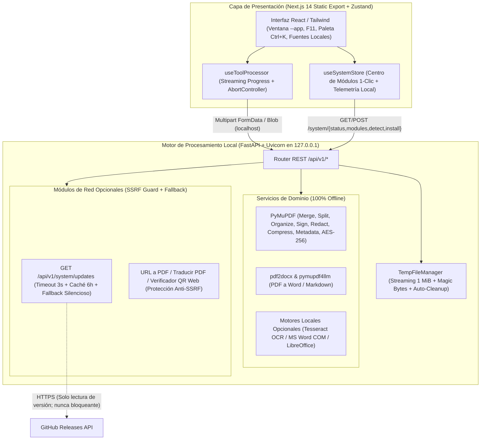

<div align="center">
  
  <br><br>

  # OpenPDF v2.2.0

  [](https://opensource.org/licenses/MIT)
  [](https://github.com/albert-dilas/OpenPDF/actions/workflows/ci.yml)
  [](#arquitectura-local-first-offline--online)
  []()
  [](https://www.python.org/)
  [](https://nextjs.org/)
  [](https://albert-dilas.github.io/OpenPDF)

  **Plataforma Local-First de código abierto para el procesamiento, conversión, firma, censura, optimización y protección de documentos PDF con privacidad estricta.**
  <br>
  *Ejecución local en el equipo complementada con utilidades Online protegidas contra SSRF.*

</div>

---

## Tabla de Contenidos
- [Descarga e Instalación (Usuarios)](#descarga-e-instalación-usuarios)
- [Descripción General](#descripción-general)
- [Capturas de Pantalla](#capturas-de-pantalla)
- [Catálogo de Herramientas (21 Módulos)](#catálogo-de-herramientas-21-módulos)
- [Centro de Módulos Opcionales y Endpoints del Sistema](#centro-de-módulos-opcionales-y-endpoints-del-sistema)
- [Arquitectura Local-First (Offline / Online)](#arquitectura-local-first-offline--online)
- [Guía de Desarrollo y Ejecución Local](#guía-de-desarrollo-y-ejecución-local)
- [Compilación y Empaquetado (.exe / Instalador)](#compilación-y-empaquetado-exe--instalador)
- [Pruebas y Calidad](#pruebas-y-calidad)
- [Contribuir](#contribuir)
- [Licencia](#licencia)

---

## Descarga e Instalación (Usuarios)

Para instalar y ejecutar **OpenPDF** en Windows sin compilar desde el código fuente:

1. Accede a la sección de [**Releases**](../../releases) de este repositorio.
2. Descarga el instalador oficial de la versión más reciente ([`OpenPDF_Setup_v2.2.0.exe`](https://github.com/albert-dilas/OpenPDF/releases/download/v2.2.0/OpenPDF_Setup_v2.2.0.exe)) o el ejecutable portátil autónomo ([`OpenPDF.exe`](https://github.com/albert-dilas/OpenPDF/releases/download/v2.2.0/OpenPDF.exe)).
3. Ejecuta el instalador y sigue las instrucciones del asistente.

---

## Descripción General

**OpenPDF** es una suite de escritorio y servidor local autoalojable diseñada para organizaciones y profesionales que requieren manipular documentos confidenciales sin exponerlos a servicios en la nube de terceros. Toda la manipulación criptográfica, firma manuscrita, censura irreversible (redacción física), renderizado, compresión, reconocimiento óptico de caracteres (OCR) y conversión documental se ejecuta localmente mediante un motor asíncrono en Python (**FastAPI + PyMuPDF + OpenCV**) acoplado a una interfaz estática compilada en **Next.js 14 + Tailwind CSS**, e incluye además herramientas asistidas por red con validación anti-SSRF.

### Pilares de Ingeniería (v2.2.0)
- **Privacidad Estricta (`[LOCAL-FIRST]`)**: Los 18 módulos de procesamiento local operan sin conexión alguna; los 3 módulos con acceso a Internet están explícitamente señalizados con la insignia `Online` e incorporan protección anti-SSRF.
- **Centro de Módulos Opcionales en 1 Clic**: Instalación desatendida con 1 clic (`winget` + descarga automática del paquete de idioma Español `spa.traineddata`), autodetección profunda en el Registro de Windows y selector gráfico nativo de ejecutables `.exe` sin necesidad de configurar variables de entorno `PATH`.
- **Soporte Dual para Word a PDF**: Conversión local de `.doc`/`.docx` a PDF compatible tanto con **Microsoft Word (`WINWORD.EXE` vía COM nativo)** como con **LibreOffice (`soffice.exe` en modo *headless*)**.
- **Experiencia de Escritorio Inmersiva**: Apertura en ventana de aplicación dedicada (`--app`), Modo Inmersivo a pantalla completa (`F11`), Paleta de Comandos instantánea (`Ctrl+K`), barra de estado de telemetría local y sistema iconográfico vectorial SVG unificado de alta densidad (icono HD de 256px *supersampled* desde 1024px).
- **Ingesta en Streaming con Memoria Constante**: Validación de formato por *magic bytes* en cabecera y escritura en disco por bloques de `1 MiB`, con recolección y borrado garantizado de archivos temporales.
- **Interfaz Técnica y Accesible**: Búsqueda en tiempo real, clasificación por categorías funcionales, soporte nativo para modo claro y modo oscuro con tipografías locales (*Geist Sans* y *Geist Mono*) 100% offline, barra de progreso por fases con cancelación activa (`AbortController`) y diagnóstico del motor local en vivo.
- **Ajustes y Personalización Reactiva**: Panel de preferencias (`/settings`) para personalizar temas, modo inmersivo, cuadrícula compacta, opciones de procesamiento, comprobación de actualizaciones en tiempo real contra GitHub Releases (con diálogo interactivo Actualizar/Cancelar) y centro integrado de opiniones, propuestas de funciones y reporte de errores.

---

## Capturas de Pantalla

<div align="center">
  
  <br>
  <em>Figura 1: Panel principal con indicador de estado del motor local, buscador en tiempo real, Paleta de Comandos (Ctrl+K) y barra de estado de telemetría.</em>
</div>
<br>
<div align="center">
  
  <br>
  <em>Figura 2: Catálogo de los 21 módulos de procesamiento PDF en modo oscuro.</em>
</div>
<br>
<div align="center">
  
  <br>
  <em>Figura 3: Espacio de trabajo interactivo para organizar páginas con miniaturas en tiempo real, rotación individual y reordenamiento.</em>
</div>

---

## Catálogo de Herramientas (21 Módulos)

| Categoría | Herramienta | Ruta / Endpoint | Descripción Técnica | Ejecución |
| :--- | :--- | :--- | :--- | :---: |
| **Organizar** | **Unir PDF** | `/merge-pdf` (`POST /api/v1/merge/`) | Combina múltiples documentos PDF en el orden especificado mediante *drag & drop*. | 100% Offline |
| **Organizar** | **Dividir PDF** | `/split-pdf` (`POST /api/v1/split/`) | Extrae todas las páginas o rangos definidos (`1,3-5,7`) en un archivo comprimido `.zip`. | 100% Offline |
| **Organizar** | **Organizar PDF** | `/organize-pdf` (`POST /api/v1/organize/`) | Previsualiza miniaturas por página para reordenar, rotar en incrementos de `90°` y descartar páginas. | 100% Offline |
| **Organizar** | **Rotar PDF** | `/rotate-pdf` (`POST /api/v1/rotate/`) | Aplica rotación uniforme (`90°`, `180°` o `270°`) sobre la totalidad del documento. | 100% Offline |
| **Optimizar** | **Comprimir PDF** | `/compress-pdf` (`POST /api/v1/compress/`) | Compresión en tres niveles (`low`, `medium`, `high` con *downsampling* de imágenes) y reporte de reducción. | 100% Offline |
| **Optimizar** | **OCR PDF** | `/ocr-pdf` (`POST /api/v1/ocr/`) | Genera una capa de texto seleccionable y buscable sobre documentos escaneados vía Tesseract OCR local. | 100% Offline* |
| **Convertir** | **PDF a Word** | `/pdf-to-word` (`POST /api/v1/pdf-to-word/`) | Reconstruye diseño, tablas y párrafos en un archivo editable `.docx` (`pdf2docx`). | 100% Offline |
| **Convertir** | **Word a PDF** | `/word-to-pdf` (`POST /api/v1/word-to-pdf/`) | Convierte documentos `.doc`/`.docx` a estándar PDF mediante **Microsoft Word (`WINWORD.EXE` vía COM)** o **LibreOffice (`soffice.exe`)**. | 100% Offline* |
| **Convertir** | **JPG a PDF** | `/jpg-to-pdf` (`POST /api/v1/jpg-to-pdf/`) | Ensambla secuencias de imágenes JPG o PNG en un único documento PDF multipágina. | 100% Offline |
| **Convertir** | **PDF a JPG** | `/pdf-to-jpg` (`POST /api/v1/pdf-to-jpg/`) | Rasteriza cada página del documento como imagen JPG de alta resolución empaquetada en `.zip`. | 100% Offline |
| **Convertir** | **PDF a Markdown** | `/pdf-to-markdown` (`POST /api/v1/pdf-to-markdown/`) | Extrae contenido estructurado en formato Markdown (`.md`) para documentación técnica y control de versiones. | 100% Offline |
| **Convertir** | **Web / URL a PDF** | `/url-to-pdf` (`POST /api/v1/url-to-pdf/`) | Captura artículos y páginas web públicas por URL (modo lectura o completo) con protección anti-SSRF. | Online |
| **Convertir** | **Traducir PDF** | `/translate-pdf` (`POST /api/v1/translate/`) | Traduce los bloques de texto del PDF a múltiples idiomas generando un PDF maquetado o bilingüe. | Online |
| **Editar** | **Marca de Agua** | `/watermark-pdf` (`POST /api/v1/watermark/`) | Superpone texto diagonal semitransparente centrado en todas las páginas del documento. | 100% Offline |
| **Editar** | **Números de Página** | `/page-numbers-pdf` (`POST /api/v1/page-numbers/`) | Inserta numeración secuencial `Página X de Y` en el margen inferior del documento. | 100% Offline |
| **Editar** | **Editar Metadatos** | `/metadata-pdf` (`POST /api/v1/metadata/`) | Inspecciona, modifica o limpia los atributos estándar (`Título`, `Autor`, `Asunto`, `Palabras clave`). | 100% Offline |
| **Editar** | **Código QR Web** | `/qr-pdf` (`POST /api/v1/qr/{stamp,inspect}`) | Estampa códigos QR verificando en línea la URL destino o escanea y audita los códigos QR del PDF. | Online / Local |
| **Seguridad** | **Firmar / Sellar PDF** | `/sign-pdf` (`POST /api/v1/sign/`) | Permite dibujar firma manuscrita en pantalla o cargar imagen PNG/JPG de sello con pie de firma. | 100% Offline |
| **Seguridad** | **Censurar / Redactar** | `/redact-pdf` (`POST /api/v1/redact/`) | Purga física e irreversiblemente textos confidenciales, correos, teléfonos, identificadores y URLs. | 100% Offline |
| **Seguridad** | **Proteger PDF** | `/protect-pdf` (`POST /api/v1/protect/`) | Cifra documentos bajo estándar **AES-256** con clave de apertura y permisos. | 100% Offline |
| **Seguridad** | **Desbloquear PDF** | `/unlock-pdf` (`POST /api/v1/unlock/`) | Elimina el cifrado y las restricciones de acceso de un PDF autenticado mediante su contraseña. | 100% Offline |

> \* *Motores opcionales gestionados desde la interfaz*: **OCR PDF** utiliza **Tesseract OCR** (`tesseract.exe`) y **Word a PDF** soporta tanto **Microsoft Word** (`WINWORD.EXE` vía COM nativo) como **LibreOffice** (`soffice.exe`). Ambos pueden instalarse en 1 clic, autodetectarse en el Registro de Windows o vincularse mediante el selector gráfico de archivos integrado sin necesidad de modificar variables de entorno `PATH`.

---

## Centro de Módulos Opcionales y Endpoints del Sistema

La versión `v2.2.0` incorpora un subsistema dedicado para diagnosticar, autodetectar, vincular e instalar motores locales opcionales directamente desde la aplicación de escritorio:

| Endpoint | Método | Función Técnica |
| :--- | :---: | :--- |
| `/api/v1/system/status` | `GET` | Estado operativo del motor local, versión activa y resumen de capacidades instaladas. |
| `/api/v1/system/modules` | `GET` | Inventario detallado de los módulos opcionales (`tesseract`, `word_to_pdf`), ruta resuelta, fuente de detección (`custom_config`, `bundled`, `system_path`, `auto_detected`) y disponibilidad de `winget`. |
| `/api/v1/system/detect-modules` | `POST` | Ejecuta un escaneo profundo en el Registro de Windows (`HKLM`/`HKCU`), rutas de instalación estándar, `PATH` y directorio portátil `backend/bin/`. |
| `/api/v1/system/configure-module` | `POST` | Valida y persiste manualmente la ruta a un ejecutable (`.exe` o carpeta de instalación) en la configuración local del usuario. |
| `/api/v1/system/pick-module-binary` | `POST` | Abre el diálogo nativo de selección de archivos de Windows para elegir `tesseract.exe`, `WINWORD.EXE` o `soffice.exe` sin tocar variables de entorno. |
| `/api/v1/system/install-module` | `POST` | Ejecuta la instalación desatendida en 1 clic mediante `winget` y descarga automáticamente el modelo de idioma Español (`spa.traineddata`) para Tesseract OCR. |
| `/api/v1/system/updates` | `GET` | Consulta no bloqueante de nuevas versiones en GitHub Releases con *timeout* de `3s`, notas de versión, URL de descarga y *fallback* silencioso offline. |
| `/api/v1/system/feedback` | `POST` | Registra retroalimentación local estructurada (propuestas de funciones, reportes de errores y opiniones) con validación estricta en Pydantic. |

---

## Arquitectura Local-First (Offline / Online)



### Garantías de Operación Offline y Resiliencia
1. **Autonomía Offline en el Núcleo**: Las fuentes tipográficas, hojas de estilo, iconos vectoriales SVG y lógica de interfaz se sirven íntegramente desde el paquete estático local.
2. **Verificación de Actualizaciones con *Fallback* Silencioso**: El endpoint `GET /api/v1/system/updates` realiza una consulta externa hacia GitHub Releases (con un tiempo límite estricto de `3 segundos` y almacenamiento en caché de `6 horas`). Si el entorno carece de conexión a internet, devuelve `{ "online": false, "update_available": false }` con estado HTTP `200 OK` sin interrumpir el flujo de trabajo. Puede deshabilitarse definiendo la variable de entorno `OPENPDF_DISABLE_UPDATE_CHECK=1`.
3. **Asignación Dinámica de Puerto, Ventana Dedicada y Endurecimiento de Rutas**: Al iniciarse como ejecutable de escritorio, el servidor selecciona automáticamente el primer puerto disponible en el rango `8000–8010` (o el indicado en `OPENPDF_PORT`), lanza una ventana nativa dedicada en modo aplicación (`--app`) cuando detecta Microsoft Edge o Google Chrome, y valida todas las rutas de archivos estáticos mediante `Path.resolve()` para impedir vulnerabilidades de *path traversal*.

---

## Guía de Desarrollo y Ejecución Local

### Requisitos Previos
- **Python 3.12+**
- **Node.js 18+ / 20+**
- *(Opcional)* **Tesseract OCR** y **Microsoft Word** o **LibreOffice** (instalables o vinculables en 1 clic desde el Centro de Módulos de la aplicación).

### 1. Iniciar el Servidor Backend
```powershell
cd backend
python -m venv .venv
.\.venv\Scripts\activate
pip install -r requirements-dev.txt

# Iniciar el servidor en http://127.0.0.1:8000
uvicorn app.main:app --host 127.0.0.1 --port 8000 --reload
```

### 2. Ejecutar o Compilar el Frontend
```powershell
cd frontend
npm install

# Entorno de desarrollo con recarga en caliente (http://localhost:3000)
npm run dev

# Generar exportación estática en frontend/out/ para servirla desde FastAPI
npm run build
```

---

## Compilación y Empaquetado (.exe / Instalador)

El repositorio incluye scripts automatizados para generar tanto el binario autónomo (`OpenPDF.exe`) como el instalador de Windows (`OpenPDF_Setup_v2.2.0.exe`):

```powershell
# 1. Regenerar iconos HD (256px supersampled desde 1024px) y banners del instalador
python scripts/prepare_assets.py

# 2. Compilar frontend, empaquetar ejecutable PyInstaller y generar instalador Inno Setup
python scripts/build_installer.py
```

Los artefactos compilados se depositan en el directorio `dist/`. Consulta [BUILD_GUIDE.md](BUILD_GUIDE.md) para información detallada sobre el proceso de construcción.

---

## Pruebas y Calidad

```powershell
# Suite de pruebas automatizadas del backend (80+ tests de integración, módulos y seguridad)
cd backend
.\.venv\Scripts\python -m pytest -v

# Análisis estático y verificación de tipos del frontend
cd ../frontend
npm run lint
npx tsc --noEmit
```

---

## Contribuir

Consulta [CONTRIBUTING.md](CONTRIBUTING.md) para revisar las pautas de arquitectura, convenciones de código y proceso de envío de *Pull Requests*.

---

## Licencia

Este proyecto se distribuye bajo los términos de la [Licencia MIT](LICENSE).
