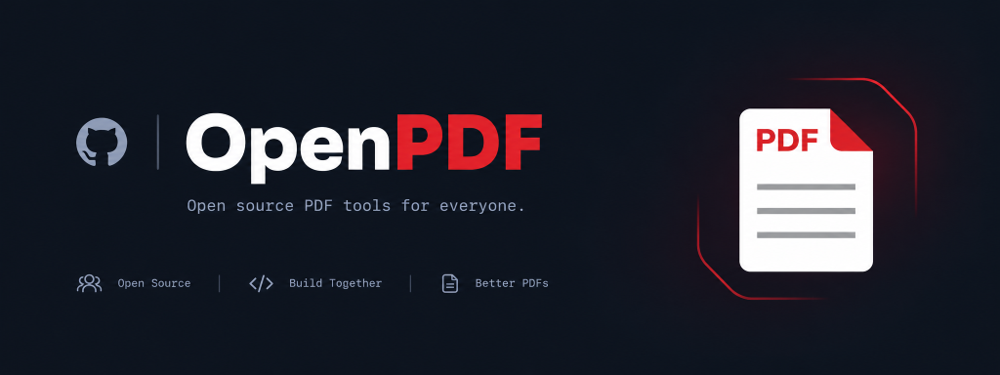
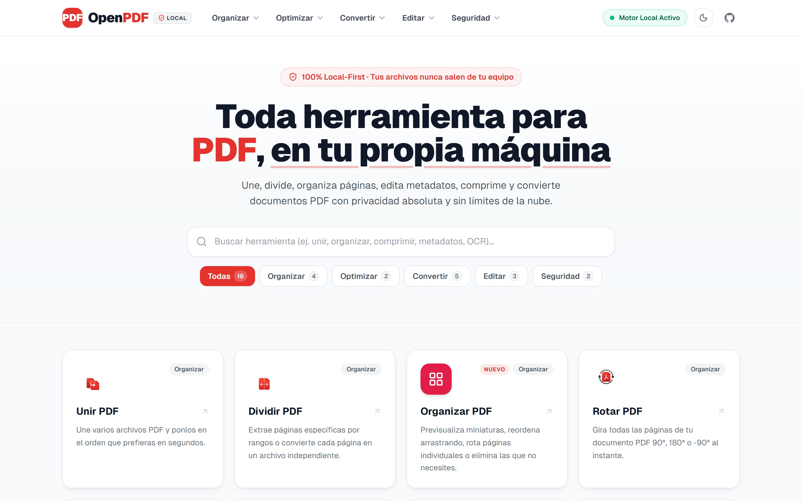
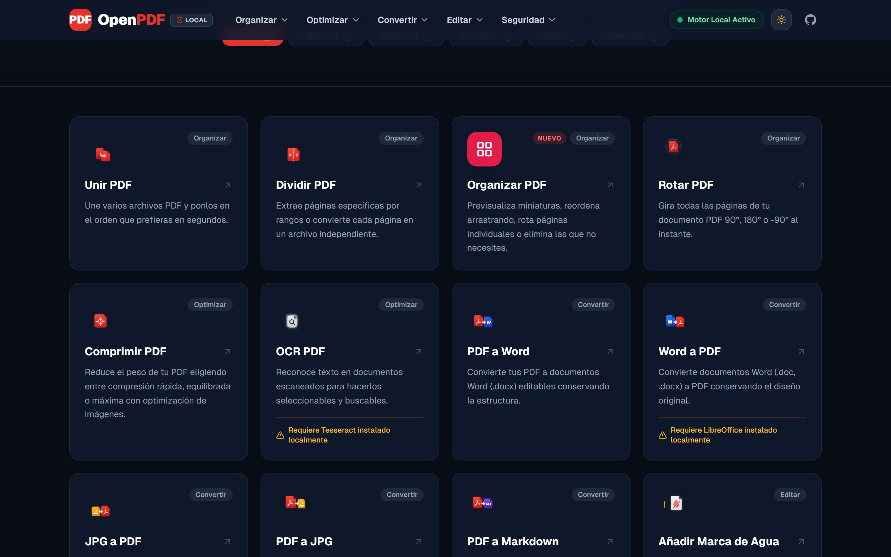
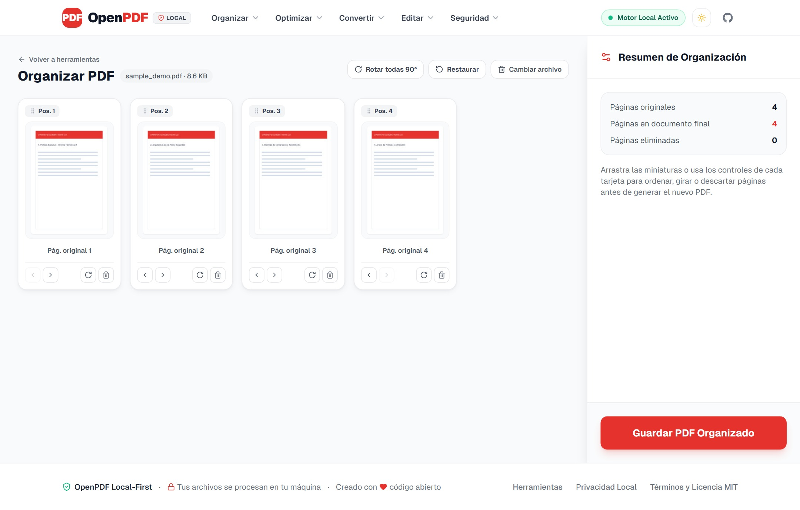
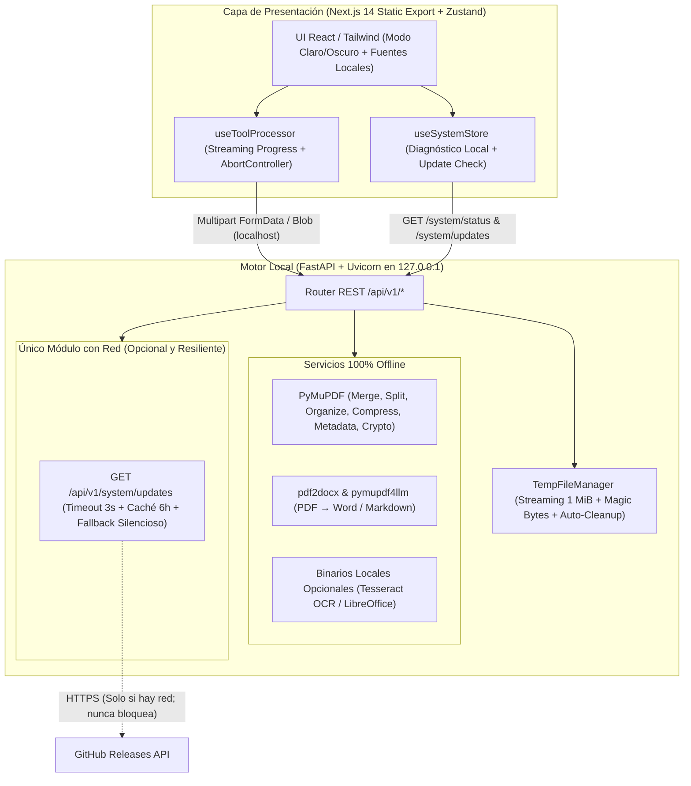

<div align="center">
  
  <br><br>

  # OpenPDF v2.0

  [](https://opensource.org/licenses/MIT)
  [](https://github.com/albert-dilas/OpenPDF/actions/workflows/ci.yml)
  [](#️-arquitectura-local-first-offline--online)
  []()
  [](https://www.python.org/)
  [](https://nextjs.org/)
  [](https://albert-dilas.github.io/OpenPDF)

  **Suite de escritorio *Local-First* y de código abierto para procesar, convertir, optimizar y proteger documentos PDF con privacidad absoluta.**
  <br>
  *Tus archivos nunca salen de tu equipo.*

</div>

---

## 📑 Tabla de Contenidos
- [Descarga e Instalación (Usuarios)](#-descarga-e-instalación-usuarios)
- [Descripción General](#-descripción-general)
- [Capturas de Pantalla](#-capturas-de-pantalla)
- [Catálogo de Herramientas (16 Funciones)](#-catálogo-de-herramientas-16-funciones)
- [Arquitectura Local-First (Offline / Online)](#️-arquitectura-local-first-offline--online)
- [Guía de Desarrollo y Ejecución Local](#️-guía-de-desarrollo-y-ejecución-local)
- [Compilación y Empaquetado (.exe / Instalador)](#-compilación-y-empaquetado-exe--instalador)
- [Pruebas y Calidad](#-pruebas-y-calidad)
- [Contribuir](#-contribuir)
- [Licencia](#-licencia)

---

## 📥 Descarga e Instalación (Usuarios)

Si solo deseas utilizar **OpenPDF** en Windows sin compilar desde el código fuente:

1. Ve a la sección de [**Releases**](../../releases) de este repositorio.
2. Descarga el instalador oficial más reciente: `OpenPDF_Setup_v2.x.x.exe`.
3. Ejecuta el instalador y sigue los pasos del asistente.

---

## 🔍 Descripción General

**OpenPDF** nace como una alternativa privada, rápida y autoalojable (*self-hosted* / *desktop*) a las suites PDF en la nube. Toda la manipulación criptográfica, renderizado, compresión, OCR y conversión de documentos se ejecuta **100% en tu máquina local** mediante un motor asíncrono en Python (**FastAPI + PyMuPDF**) acoplado a una interfaz moderna en **Next.js 14 + Tailwind CSS**.

### Pilares de Ingeniería (v2.0)
- **Privacidad Total (`[LOCAL-FIRST]`)**: Ningún documento ni metadato se transmite a servidores externos.
- **Streaming con Huella de Memoria Constante**: Validación de *magic bytes* en cabecera e ingesta por bloques de `1 MiB` con limpieza garantizada de archivos temporales.
- **UI/UX Moderna y Accesible**: Buscador instantáneo, filtrado por categorías, soporte nativo para **Modo Claro / Oscuro** (sin parpadeos y con fuentes locales *Geist* 100% offline), barra de progreso por fases con cancelación en vivo (`AbortController`) y diagnóstico del motor local en tiempo real.

---

## 📸 Capturas de Pantalla

<div align="center">
  
  <br>
  <em>Figura 1: Panel principal con indicador de Motor Local Activo, buscador instantáneo y filtro por categorías.</em>
</div>
<br>
<div align="center">
  
  <br>
  <em>Figura 2: Catálogo de las 16 herramientas PDF y soporte completo de Modo Oscuro.</em>
</div>
<br>
<div align="center">
  
  <br>
  <em>Figura 3: Espacio de trabajo interactivo (Organizar PDF con miniaturas en tiempo real, rotación individual y reordenamiento).</em>
</div>

---

## 🚀 Catálogo de Herramientas (16 Funciones)

| Categoría | Herramienta | Ruta / Endpoint | Descripción Técnica | Modo |
| :--- | :--- | :--- | :--- | :---: |
| **Organizar** | **Unir PDF** | `/merge-pdf` (`POST /api/v1/merge/`) | Combina múltiples PDFs en el orden elegido mediante *drag & drop*. | 🟢 100% Offline |
| **Organizar** | **Dividir PDF** | `/split-pdf` (`POST /api/v1/split/`) | Extrae todas las páginas o rangos personalizados (`1,3-5,7`) en un archivo `.zip`. | 🟢 100% Offline |
| **Organizar** | **Organizar PDF** *(Nuevo)* | `/organize-pdf` (`POST /api/v1/organize/`) | Vista previa de miniaturas por página para reordenar, rotar `90°` y eliminar páginas. | 🟢 100% Offline |
| **Organizar** | **Rotar PDF** | `/rotate-pdf` (`POST /api/v1/rotate/`) | Rota todas las páginas de un documento (`90°`, `180°` o `270°`). | 🟢 100% Offline |
| **Optimizar** | **Comprimir PDF** *(Mejorado)* | `/compress-pdf` (`POST /api/v1/compress/`) | 3 niveles (`low`, `medium`, `high` con *downsampling* de imágenes) y métricas de ahorro en vivo. | 🟢 100% Offline |
| **Optimizar** | **OCR PDF** | `/ocr-pdf` (`POST /api/v1/ocr/`) | Convierte PDFs escaneados en documentos con texto seleccionable vía Tesseract OCR local. | 🟢 100% Offline* |
| **Convertir** | **PDF a Word** | `/pdf-to-word` (`POST /api/v1/pdf-to-word/`) | Reconstruye diseños, tablas y párrafos en formato editable `.docx` (`pdf2docx`). | 🟢 100% Offline |
| **Convertir** | **Word a PDF** | `/word-to-pdf` (`POST /api/v1/word-to-pdf/`) | Convierte documentos `.doc`/`.docx` a PDF de alta fidelidad mediante LibreOffice *headless*. | 🟢 100% Offline* |
| **Convertir** | **JPG a PDF** | `/jpg-to-pdf` (`POST /api/v1/jpg-to-pdf/`) | Ensambla una o varias imágenes JPG/PNG en un documento PDF multipágina. | 🟢 100% Offline |
| **Convertir** | **PDF a JPG** | `/pdf-to-jpg` (`POST /api/v1/pdf-to-jpg/`) | Renderiza cada página del PDF como imagen JPG de alta resolución en un `.zip`. | 🟢 100% Offline |
| **Convertir** | **PDF a Markdown** | `/pdf-to-markdown` (`POST /api/v1/pdf-to-markdown/`) | Extrae texto estructurado en Markdown (`.md`) listo para flujos de trabajo RAG y LLMs. | 🟢 100% Offline |
| **Editar** | **Marca de Agua** | `/watermark-pdf` (`POST /api/v1/watermark/`) | Estampa texto diagonal semitransparente centrado en todas las páginas. | 🟢 100% Offline |
| **Editar** | **Números de Página** | `/page-numbers-pdf` (`POST /api/v1/page-numbers/`) | Inserta numeración automática `Página X de Y` en el pie del documento. | 🟢 100% Offline |
| **Editar** | **Editar Metadatos** *(Nuevo)* | `/metadata-pdf` (`POST /api/v1/metadata/`) | Inspecciona, edita o limpia `Título`, `Autor`, `Asunto` y `Palabras clave` del PDF. | 🟢 100% Offline |
| **Seguridad** | **Proteger PDF** | `/protect-pdf` (`POST /api/v1/protect/`) | Cifra documentos con estándar **AES-256** utilizando contraseña de usuario y propietario. | 🟢 100% Offline |
| **Seguridad** | **Desbloquear PDF** | `/unlock-pdf` (`POST /api/v1/unlock/`) | Elimina el cifrado y las restricciones de un PDF conociendo su contraseña. | 🟢 100% Offline |

> \* *Nota sobre dependencias opcionales del sistema*: **OCR PDF** detecta automáticamente **Tesseract OCR** y **Word a PDF** detecta **LibreOffice** (en `PATH`, rutas estándar del sistema o en `backend/bin/`). Si no están instalados, el panel de estado (`GET /api/v1/system/status`) informa en la interfaz con instrucciones claras sin afectar al resto de herramientas.

---

## 🏗️ Arquitectura Local-First (Offline / Online)



### Garantías de Resiliencia Offline/Online
1. **Autonomía Offline en el Núcleo**: Todas las fuentes tipográficas (*Geist Sans* y *Geist Mono*), iconos y scripts se sirven localmente. Ninguna herramienta de procesamiento PDF realiza peticiones externas.
2. **Único Punto de Red con *Fallback* Estricto**: El endpoint `GET /api/v1/system/updates` consulta nuevas versiones en GitHub Releases con un *timeout* máximo de `3 segundos` y caché en memoria de `6 horas`. Si el equipo no tiene conexión a internet o el firewall bloquea la salida, responde `{ "online": false, "update_available": false }` con código `200 OK` sin lanzar errores ni mostrar avisos intrusivos. Puede desactivarse por completo con `OPENPDF_DISABLE_UPDATE_CHECK=1`.
3. **Selección Dinámica de Puerto y Seguridad**: Al ejecutarse como aplicación de escritorio, el servidor busca automáticamente un puerto libre en el rango `8000–8010` (o usa `OPENPDF_PORT`) y protege el servidor de archivos estáticos contra ataques de *path traversal* mediante resolución estricta de rutas (`Path.resolve()`).

---

## 🛠️ Guía de Desarrollo y Ejecución Local

### Prerrequisitos
- **Python 3.12+**
- **Node.js 18+ / 20+**
- *(Opcional)* **Tesseract OCR** (para `/ocr-pdf`) y **LibreOffice** (para `/word-to-pdf`).

### 1. Configurar y ejecutar el Backend (API + Servidor Integrado)
```powershell
cd backend
python -m venv .venv
.\.venv\Scripts\activate
pip install -r requirements-dev.txt

# Iniciar servidor en http://127.0.0.1:8000
uvicorn app.main:app --host 127.0.0.1 --port 8000 --reload
```

### 2. Configurar y construir el Frontend
```powershell
cd frontend
npm install

# Modo desarrollo con recarga en caliente (http://localhost:3000)
npm run dev

# O generar el export estático en frontend/out/ para que FastAPI lo sirva todo en el puerto 8000
npm run build
```

---

## 📦 Compilación y Empaquetado (.exe / Instalador)

Para generar el ejecutable autónomo de Windows y el instalador de Inno Setup desde la raíz del proyecto:

```powershell
# 1. Compilar frontend estático y empaquetar ejecutable con PyInstaller
python scripts/build_exe.py

# 2. Generar instalador oficial de Windows con Inno Setup
python scripts/build_installer.py
```

Los artefactos finales se generan en la carpeta `dist/`. Consulta [BUILD_GUIDE.md](BUILD_GUIDE.md) para más detalles.

---

## 🧪 Pruebas y Calidad

El proyecto cuenta con una suite automatizada de pruebas de integración, validación de seguridad (*path traversal*, límites de tamaño en *streaming*, *magic bytes*) y verificación de tipos:

```powershell
# Ejecutar suite completa del backend (55+ tests)
cd backend
.\.venv\Scripts\python -m pytest -v

# Ejecutar linter y chequeo estático de tipos del frontend
cd ../frontend
npm run lint
npx tsc --noEmit
```

---

## 🤝 Contribuir

¡Las contribuciones son bienvenidas! Lee nuestra guía [CONTRIBUTING.md](CONTRIBUTING.md) para conocer el flujo de trabajo de ramas, estándares de código y cómo proponer mejoras.

---

## 📄 Licencia

Distribuido bajo la [Licencia MIT](LICENSE). Consulta el archivo `LICENSE` para más información.
