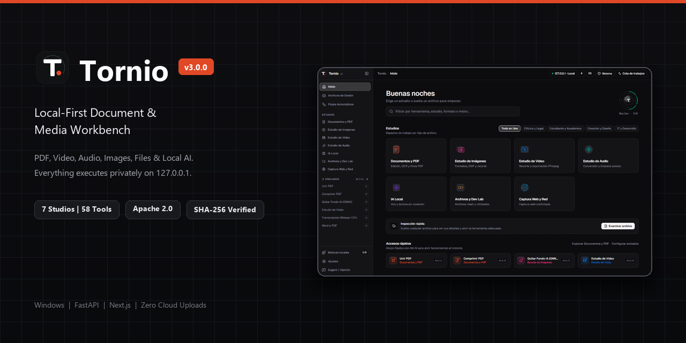
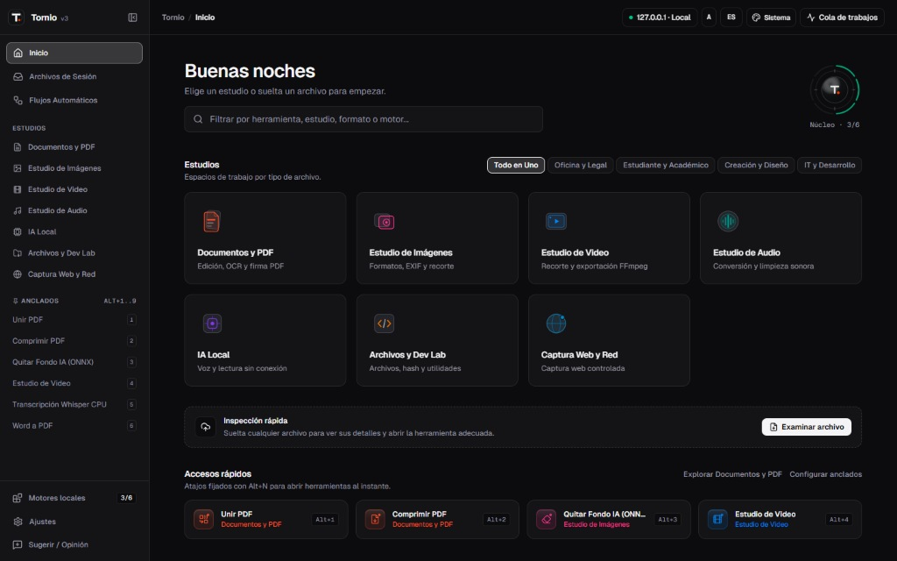
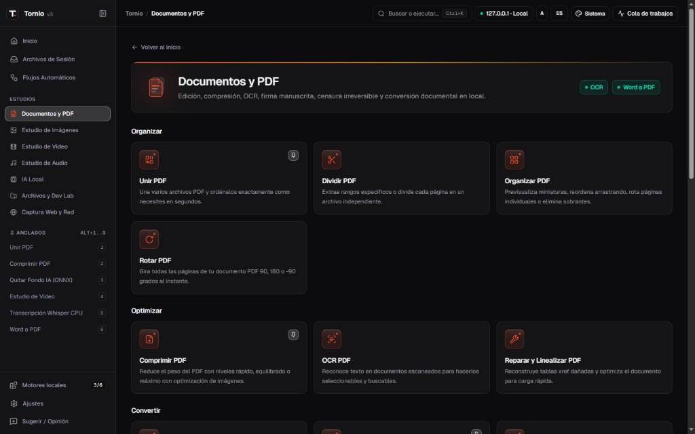
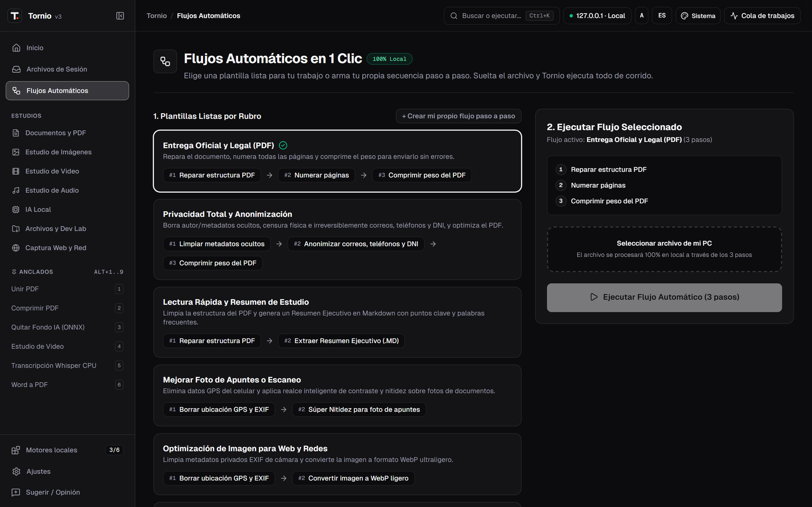

<div align="center">
  
  <br><br>

  <h1>Tornio <small>(formerly OpenPDF)</small></h1>

  <p>
    <a href="README.es.md">Leer en Espanol</a>
    &nbsp;|&nbsp;
    <a href="https://albert-dilas.github.io/OpenPDF/">Live Website</a>
    &nbsp;|&nbsp;
    <a href="https://github.com/albert-dilas/OpenPDF/releases/tag/v3.0.0">Releases (v3.0.0)</a>
  </p>

  <p>
    <a href="https://github.com/albert-dilas/OpenPDF/releases/tag/v3.0.0"></a>
    <a href="LICENSE"></a>
    <a href="https://github.com/albert-dilas/OpenPDF/actions/workflows/ci.yml"></a>
    
    
    
  </p>

  <p>
    <strong>Free, open-source, <code>[LOCAL-FIRST]</code> desktop workbench for documents, video, audio, images, security utilities, and local CPU AI.</strong><br>
    Everything executes privately on <code>127.0.0.1</code> without uploading files or metadata to external servers.
  </p>
</div>

---

## Download & Cryptographic Verification (`v3.0.0`)

Prebuilt Windows x64 binaries package the Python FastAPI engine, domain libraries, Windows system-tray runtime, and the 76-route offline Next.js interface with no manual Python or Node.js setup required.

| Artifact | Format | Size | SHA-256 Digest | Download |
| :--- | :--- | :---: | :--- | :---: |
| **`Tornio_Setup_v3.0.0.exe`** | Per-user Windows Installer (3-step wizard, no UAC) | `158.0 MB` | `0c848775e54b30a7028b3aa8896388016b8c6e3fba96f0230f6640a8b6509cc7` | [Download Installer](https://github.com/albert-dilas/OpenPDF/releases/download/v3.0.0/Tornio_Setup_v3.0.0.exe) |
| **`Tornio.exe`** | Standalone Portable Executable | `161.1 MB` | `026f22a99469b4cb5e2e7514819382648469647e8afefa5454804ac1c12bbbf1` | [Download Portable](https://github.com/albert-dilas/OpenPDF/releases/download/v3.0.0/Tornio.exe) |
| **`SHA256SUMS.txt`** | Release Integrity Manifest (used by Self-Updater) | — | — | [View Manifest](https://github.com/albert-dilas/OpenPDF/releases/download/v3.0.0/SHA256SUMS.txt) |

Verify integrity locally in PowerShell before running:

```powershell
Get-FileHash .\Tornio_Setup_v3.0.0.exe -Algorithm SHA256
```

> **Existing OpenPDF v2.x users**: Tornio automatically migrates `%LOCALAPPDATA%\OpenPDF\config.json` and `tessdata\*.traineddata` into `%LOCALAPPDATA%\Tornio` on first launch without overwriting existing Tornio settings.

---

## Interface Preview

<div align="center">
  
  <br>
  <em>Figure 1: Tornio Home featuring the calibrated Precision Core (6-engine telemetry &amp; drop zone), 7 Studios, career workspace presets, and Alt+1..9 shortcuts.</em>
</div>

<br>

<div align="center">
  
  <br>
  <em>Figure 2: Documents &amp; PDF Studio with live local capability badges (OCR / Word-to-PDF) and Dual-Tone architectural tool cards.</em>
</div>

<br>

<div align="center">
  
  <br>
  <em>Figure 3: Multi-step local pipeline builder executing sequential file transformations privately in memory and local temp storage.</em>
</div>

---

## 7 Studios & 58 Local Tools

Tornio organizes 58 active tools (`TOOL_COUNT = 58`) across 7 specialized Studios inside one consistent workbench:

| Studio | Active Tools | Core Capabilities &amp; Local Engines | Execution Model |
| :--- | :---: | :--- | :--- |
| **Documents &amp; PDF** | `24` | Merge, Split, Organize, Rotate, Compress, OCR (Tesseract), Repair/Linearize, PDF to Word/JPG/Markdown/CSV Tables, Word to PDF (MS Word COM / LibreOffice), Watermark, Page Numbers, Metadata, Visual/Text Diff (`pdf-diff`), Handwritten Signature/Stamp, Irreversible Physical Redaction, AES Encryption/Unlock, URL-to-PDF, Translate PDF, QR Stamp/Inspect | 21 100% Offline, 3 Anti-SSRF Web |
| **Video Studio** | `8` | Interactive `ffprobe` + IN/OUT trim workbench with live SSE queue, Video to GIF, Extract Audio, Compress/Transcode, Contact-Sheet Thumbnails, Burn Subtitles, Merge Clips, Speed Multiplier (`FFmpeg`) | 100% Offline (Local Engine) |
| **Audio Studio** | `6` | Format Conversion (`MP3`/`WAV`/`FLAC`/`OGG`/`M4A`), Precision Trim/Fade, EBU R128 Loudness Normalization, Denoise Filter, Track Merge, ID3 Metadata Editor (`FFmpeg`) | 100% Offline (Local Engine) |
| **Images Studio** | `7` | WebP/AVIF Converter &amp; Document Scan Sharpness Enhancer, Optimizer, Resize/Crop, EXIF/GPS Metadata Scrubber, Local `U2NetP` ONNX / OpenCV Background Removal, ICO/Favicon Builder, Dominant Palette Inspector | 100% Offline |
| **Files &amp; Dev Lab** | `6` | ZIP/TAR/GZ Archive Inspector &amp; Builder, SHA-256 Hash Verifier, `Scrypt + AES-256-GCM` Local Encrypted Vault, JSON/YAML/CSV/XML Transformer, Offline Regex &amp; Text Diff Lab, Batch SVG/PNG QR Generator | 100% Offline |
| **Local AI Studio** | `4` | Offline CPU Speech Transcription (`faster-whisper` -> `SRT`/`TXT`), Local Windows `SAPI5` Text-to-Speech Narration, Extractive Document Summarizer, Structured RAG Chunker | 100% Offline |
| **Web &amp; Online Capture** | `3` | Media Stream Archiver (`yt-dlp`), Clean Web-to-Markdown Article Clipper, HTTP Redirect &amp; TLS Header Inspector (`safe_public_get` Anti-SSRF) | Intentional Web + Anti-SSRF |

---

## Core Desktop & Engineering Capabilities

- **Calibrated Precision Core (`EngineOrb3D`)**: Displays live local engine segments (`6` engines), real-time job progress, clickable CPU/RAM and free-disk telemetry popover, 1-click temp storage purge, and direct drag-and-drop file inspection.
- **Session Files &amp; Multi-Step Pipelines**: Inspect any file via `/workspace`, chain outputs across studios without manual re-uploads, or run 5 prebuilt multi-step templates under `/pipelines`.
- **Configurable Desktop Lifecycle**:
  - **Clean Exit by Default (`keep_in_background: false`)**: Closing Tornio terminates the local server with zero background RAM; enable optional native `ctypes` Windows System Tray mode for instant reopen.
  - **Windows Startup &amp; Explorer Integration**: Toggle per-user HKCU Windows autostart and `"Abrir con Tornio"` Explorer context menu from the installer or *Settings -> System &amp; Desktop* without admin privileges.
  - **Single-Instance Wake**: Opening `Tornio.exe` or Explorer-selected files while running routes cleanly to the active instance via `/api/v1/system/open-window`.
- **Cryptographic Self-Updater (`SelfUpdaterManager`)**: Supports `notify`, `auto`, and offline `manual` modes (`<= 3s` check timeout, 6-hour local cache). Enforces strict GitHub HTTPS host allowlists and constant-time `SHA-256` digest verification against `SHA256SUMS.txt` before execution.
- **Safety &amp; Performance Guards**: `1 MiB` streaming uploads with magic-byte verification, pre-execution **Disk Space Quota Guard**, collision-safe numbered saving, millisecond subprocess cancellation via `X-Request-Id`, and explicit frontend Finite State Machines (`fsm.ts`).

---

## Tornio `[LOCAL-FIRST]` vs. Cloud SaaS Tools

| Capability | Tornio (`v3.0.0`) | Typical Cloud SaaS Suites |
| :--- | :--- | :--- |
| **Data Residency** | `100%` on `127.0.0.1` (documents/media stay on disk) | Uploaded to third-party cloud servers |
| **File &amp; Daily Quotas** | `500 MB` per file / `2 GB` multi-file merge, unlimited runs | Paywalled file sizes, daily limits, watermarks |
| **Network Dependency** | Core studios work air-gapped; web tools clearly labeled | Requires constant internet connection |
| **Multi-Domain Coverage** | `7` integrated Studios (`58` tools) + chained pipelines | Separate subscriptions for PDF, media, AI |
| **Auditability &amp; Integrity** | Open source (`Apache 2.0`) + `SHA256SUMS.txt` builds | Closed server pipelines |

---

## Quick Start from Source

Prerequisites: **Python 3.12+**, **Node.js 20 LTS**, and (for Windows installer builds) **Inno Setup 6**.

```powershell
git clone https://github.com/albert-dilas/OpenPDF.git
cd OpenPDF

# 1. Install frontend dependencies & export static bundle
npm --prefix frontend ci
npm --prefix frontend run build

# 2. Set up backend virtual environment
cd backend
python -m venv .venv
.\.venv\Scripts\python -m pip install --upgrade pip
.\.venv\Scripts\python -m pip install -r requirements-dev.txt
cd ..

# 3. Run local server on http://127.0.0.1:8000
.\backend\.venv\Scripts\python -m uvicorn app.main:app --app-dir backend --host 127.0.0.1 --port 8000
```

To run test suites or build standalone Windows `.exe` / installer binaries, see [BUILD_GUIDE.md](BUILD_GUIDE.md).

---

## Documentation Index

- [ARCHITECTURE.md](ARCHITECTURE.md) — System topology, loopback isolation, Anti-SSRF `safe_public_get`, quota guards, and FSM architecture
- [BUILD_GUIDE.md](BUILD_GUIDE.md) — Local environment setup, test verification, PyInstaller, and Inno Setup packaging pipeline
- [CHANGELOG.md](CHANGELOG.md) — Detailed history of changes across `v2.2.0` and `v3.0.0`
- [CONTRIBUTING.md](CONTRIBUTING.md) — Coding rules, zero-emoji policy, and PR checklist
- [SECURITY.md](SECURITY.md) — Supported versions, local threat model, and vulnerability reporting
- [CODE_OF_CONDUCT.md](CODE_OF_CONDUCT.md) — Community standards

---

## License & Legal Governance

Tornio original source code is licensed under the **Apache License, Version 2.0** ([LICENSE](LICENSE) and [NOTICE](NOTICE)).

**Combined Binary Notice**: Prebuilt Windows binaries (`Tornio.exe` and `Tornio_Setup_v3.0.0.exe`) bundle `PyMuPDF` (`fitz`) and `pymupdf4llm`, which are licensed under **GNU AGPL v3.0**. Complete corresponding source code and full third-party dependency attributions are maintained openly in this repository and itemized in [THIRD_PARTY_NOTICES.md](THIRD_PARTY_NOTICES.md). Optional external engines (`Tesseract OCR`, `FFmpeg`, `LibreOffice`, `yt-dlp`) remain separate and user-managed.

---

## Support

Tornio is free, open-source software with zero ads, paywalls, or telemetry. If it saves your team time or keeps sensitive documents off external clouds, you can support ongoing development through [GitHub Sponsors](https://github.com/sponsors/albert-dilas).
